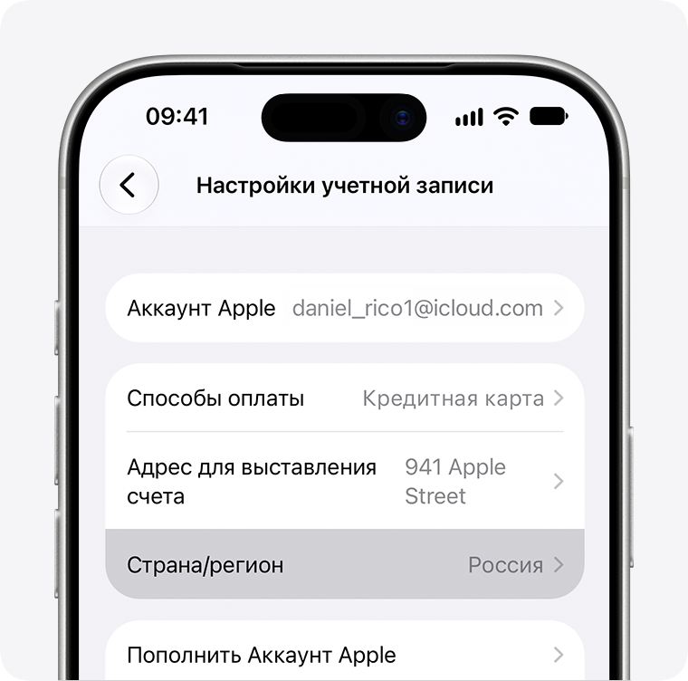
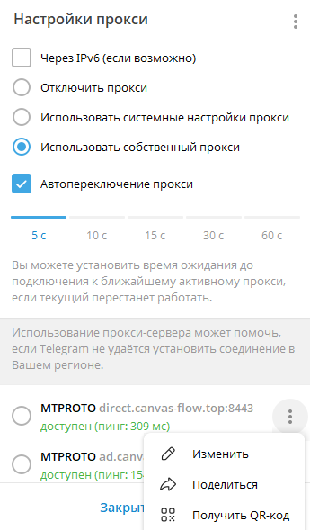
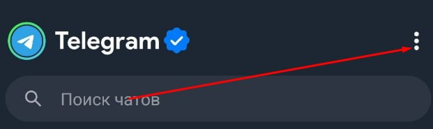
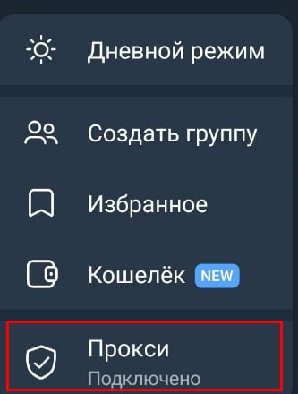
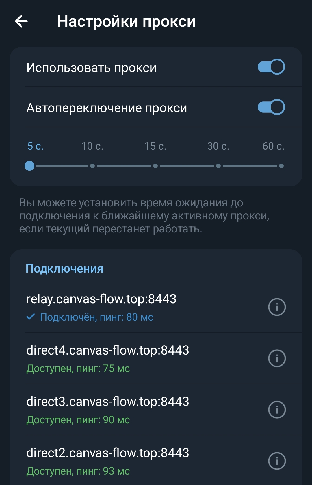
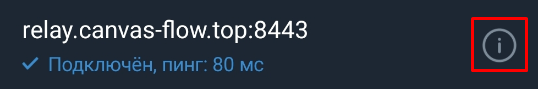

# Подключение

### Я оплатил, куда нажимать дальше, чтобы VPN заработал? {: #first-connection }

1. Нажмите постоянную кнопку «Меню» под полем ввода сообщения.
2. Нажмите «VPN» — бот покажет персональную ссылку и краткую инструкцию.
3. Скопируйте ссылку в приложение или нажмите «Подключить». Подробные инструкции со скриншотами доступны по кнопке
   «Инструкции» в этом же разделе бота.

Если используете Happ на Windows 10–11, включите **«Использовать локальный DNS»**: [инструкция](#happ-local-dns).

---

### Какую локацию для подключения выбрать?
**Белые списки** — позволяет обходить региональные ограничения, когда не открывается ничего кроме ВК и Яндекса. _Трафик покупается отдельно._

**Лучшая локация** — автоматически выбирает рабочее подключение с учётом задержки и приоритетов серверов. Если подходящих обычных направлений нет, расширяет выбор вплоть до резервных локаций «Белые списки» — тогда расходуется трафик этого пакета. Российские сайты из списка обхода открываются напрямую. Выбирайте эту локацию, если не нужна конкретная страна.

**РФ -> Зарубежная страна** — российские сайты открываются при включённом VPN, YouTube без рекламы.

**Зарубежная страна** — обычный впн, прямое подключение к зарубежной стране. Может быть стабильнее для игр.

---

### Какое приложение для подключения использовать?
Подойдёт любой современный V2Ray-клиент, умеющий передавать HWID (ID устройства).

Например, Happ или incy. Ссылки на скачивание здесь: [Кликните](general.md#apps)

Проверка режимов Proxy/TUN на компьютере — в [алгоритме решения проблем](troubleshooting.md#vpn-not-working).

---

### Как включить локальный DNS в Happ? {: #happ-local-dns }

**При настройке Happ на Windows 10–11 включите «Использовать локальный DNS».**

1. Если приложение ещё не обновлено, сначала нажмите **кнопку внизу слева**, затем в открывшемся меню выберите **«Проверить обновление»** и установите доступное обновление.
2. Отключите VPN в Happ.
3. Откройте список режимов **справа сверху** и включите **«Использовать локальный DNS»**.
4. Подключитесь заново и проверьте открытие сайтов.

Эта настройка направляет DNS-запросы через VPN. DNS определяет IP-адрес сайта по его названию. Если прямые DNS-запросы
не проходят в вашей сети, при включённом VPN сайты могут не открываться или появляется ошибка «хост не найден».

После сброса настроек Happ снова включите этот пункт. Обновление списка локаций не заменяет обновление самого приложения.
Описание функции у разработчика: [Happ Desktop](https://github.com/Happ-proxy/happ-desktop/releases/tag/4.1.1).

---

### Как сменить регион App Store на iPhone и iPad? {: #app-store-region }

1. **Заранее скачайте и обновите нужные российские приложения**, в том числе банковские. В зарубежном App Store части из них может не быть, поэтому после удаления или на новом устройстве скачать их заново может не получиться.

2. **Проверьте баланс Аккаунта Apple:** откройте App Store и нажмите значок своего профиля. Желательно, чтобы баланс был нулевым. Если на счёте есть деньги, сначала попробуйте сменить регион по шагам ниже. Только если Apple выдаст ошибку из-за остатка, израсходуйте его или обратитесь в [официальную поддержку Apple](https://support.apple.com/ru-ru/contact) за помощью со сменой региона и остатком на счёте. Возврат в российский регион тоже не всегда получается сразу: ему могут помешать баланс уже в новой стране, подписки или незавершённые покупки и возвраты.

3. Откройте **«Настройки»** на iPhone или iPad и нажмите **своё имя** вверху.

4. Выберите **«Медиаматериалы и покупки»** или **«Контент и покупки»**, затем **«Просмотреть»**. При необходимости подтвердите вход.

5. Откройте **«Страна/регион»**. Если есть кнопка **«Изменить страну или регион»**, нажмите её.

    ??? info "Показать скриншот"

        

6. Выберите **«Соединённые Штаты»**, нажмите **«Продолжить»** и примите условия. Не отменяйте все подписки заранее: если Apple сообщает, что переходу мешает конкретная подписка или семейный доступ, сначала устраните именно указанную причину.

7. В разделе **«Способ оплаты»** выберите пункт **«Нет»** — в английском интерфейсе он называется **None**. Это означает, что вы не привязываете банковскую карту. Если такого пункта нет и форма требует карту, понадобится способ оплаты, подходящий для США: заполнение одного адреса это требование не отменяет.

8. Укажите **свои имя и фамилию латиницей**.

9. **Заполните адресные поля.** Адрес не обязательно должен быть вашим личным — можно использовать эти значения:

    - **Улица / Street:** `100 Continental Dr`.
    - **Вторая строка адреса:** оставить пустой.
    - **Город / City:** `Newark`.
    - **Штат / State:** `Delaware`.
    - **Индекс / ZIP:** `19713`.

10. **Укажите свой номер телефона.** Если телефонное поле именно в адресной форме принимает только номер США, в нём можно использовать пример: код `302`, номер `4541500` (для одного поля — `3024541500`). Для входа в Аккаунт Apple, кодов подтверждения и восстановления оставьте свой доступный номер.

11. Нажмите **«Готово»** или **«Далее»**. После успешного сохранения заново откройте App Store и страницу нужного приложения.

---

### Как обновить список локаций?

Локации в приложении обновляются автоматически раз в несколько часов. Чтобы получить изменения сразу, нажмите кнопку обновления
подписки в Happ, incy или другом используемом приложении и немного подождите.

---

### Как подключить VPN на новом устройстве?

Скопируйте вашу ссылку на VPN из бота и добавьте её в приложение на новом устройстве либо воспользуйтесь QR-кодом.
Устройство добавится автоматически. Неиспользуемые устройства можно удалить через меню бота. Вы можете делиться
доступом с близкими в рамках вашего лимита.

Подробнее о лимите устройств тут: [Кликните](general.md#limit-devices)

---

### Как подключить VPN по QR-коду?

Откройте «Меню» → «VPN» → «QR-код». На новом устройстве откройте функцию сканирования QR-кода в приложении для
подключения и отсканируйте код с экрана первого устройства.

!!! warning "QR-код содержит персональную ссылку"
    Не публикуйте QR-код и не отправляйте его посторонним. Человек, получивший код, сможет использовать Ваш доступ в
    пределах установленного лимита устройств.

---

### Когда нужно обновлять ссылку на VPN?

Используйте «Меню» → «VPN» → «Обновить ссылку», если ссылка попала к постороннему или Вы хотите отозвать доступ на всех
ранее настроенных устройствах. После подтверждения старая ссылка и добавленные по ней конфигурации перестанут работать.
Новую ссылку потребуется заново добавить на все нужные устройства.

!!! danger "Операцию нельзя отменить"
    Не обновляйте ссылку без необходимости: восстановить старую ссылку после подтверждения не получится.

---

### Как подключить Телеграм-прокси на новом устройстве? {: #share-tg-proxy }

1. Убедитесь, что в боте активны дни доступа, и откройте «Меню» → «Прокси».
2. Нажмите «WEB-прокси» для нового формата или «Подключить» для обычного прокси.
3. Подтвердите добавление и включение прокси в Telegram. Достаточно один раз добавить и включить работающий вариант;
   другие предложенные прокси можно добавить как запасные.

!!! Warning "Нужна актуальная версия Telegram"
    Для подключения и отправки WEB-прокси обновите Telegram до актуальной версии с поддержкой этого формата.
    Получателю также нужна актуальная версия Telegram. Если Ваш клиент пока не поддерживает WEB-прокси,
    используйте обычный прокси или VPN.

**WEB-прокси можно поделиться так же, как обычным прокси, через настройки Telegram.**

**На телефоне:** откройте список прокси в настройках Telegram → нажмите кнопку справа от нужного прокси →
**«Поделиться»** → выберите получателя или **«Поделиться ссылкой»**.

**На компьютере:** откройте список прокси в настройках Telegram → у нужного прокси нажмите **«Поделиться»**.

Также можно скопировать ссылку из кнопки в сообщении бота: на телефоне зажмите кнопку нужного прокси →
**«Скопировать ссылку»**, на компьютере нажмите на неё правой кнопкой мыши → **«Скопировать ссылку»**.

Скриншоты ниже показывают обычный прокси; для WEB-прокси порядок такой же. Расположение кнопок зависит от версии
приложения.

Для звонков в Telegram и обхода белых списков используйте VPN. Трафик белых списков покупается отдельно.

Если ссылка на прокси попала к посторонним, выберите в боте «Меню» → «Прокси» → «Обновить ссылку» или «Обновить ссылки».
После подтверждения обновятся ссылки обоих форматов — обычного и WEB. Старые ссылки перестанут работать, а новые
потребуется подключить заново на всех нужных устройствах.

??? Info "Нажмите, чтобы посмотреть фото"
    ??? Success "Нажмите, если интересует компьютер"
        <b>Найдите кнопку в левом нижнем углу и нажмите на неё.</b>

        

        <b>Откроется список прокси, где есть все необходимые кнопки.</b>

        

    ??? Success "Нажмите, если интересует телефон"
        <b>Найдите три точки справа сверху над списком чатов (если у вас кастомная тема в Телеграм, они могут быть плохо видны, но они там есть).</b>

        
        
        <b>Нажмите на кнопку "Прокси".</b>

        
    
        <b>Откроется меню со списком прокси.</b>
    
        { width="50%" }
        
        <b>Нажмите на кнопку справа от названия прокси, чтобы увидеть кнопку "Поделиться".</b>

        

---

### Настройка на роутере
Мы не предоставляем поддержку роутеров. При самостоятельной настройке убедитесь, что ваша программа для подключения передает HWID (ID устройства), иначе подключить не получится.
